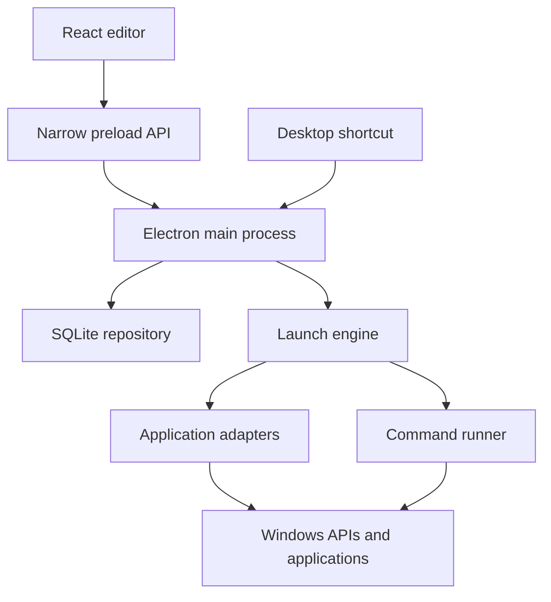

# InstaStart

**Your project, ready in one click.**

InstaStart is a local Windows desktop application for saving and launching project workspaces. A workspace can open VS Code or IntelliJ, launch other desktop applications, open selected links in Google Chrome, open notes and folders, and run Windows commands in sequence. You can create a desktop shortcut for each saved workspace.

**Version:** 0.1.1. **Target:** Windows, with builds made on the target Windows machine. **Setup:** follow [RUNNING.md](RUNNING.md) from the beginning.

The Windows dependency installation fix is described in [CHANGELOG.md](CHANGELOG.md).

## What is included

- Create, edit, search, duplicate, and delete workspaces.
- Select a project folder and use `${projectRoot}` in resource path fields.
- Open projects in VS Code or IntelliJ IDEA.
- Open multiple HTTP/HTTPS links in Google Chrome, with optional profile directory and new-window preference.
- Open another `.exe` with an argument list and working directory.
- Open notes/files with their associated application and folders in File Explorer.
- Run ordered Command Prompt, Windows PowerShell, or PowerShell 7 commands.
- Run a shared script when commands need one shell session.
- Configure command timeouts, environment overrides, and continue-after-failure behavior.
- Set prerequisites between resources using **Order and behavior → After …**.
- Inspect live command output, exit results, and saved launch history.
- Cancel a launch and explicitly retry failed resources.
- Detect common application paths and override them in Settings.
- Generate real Windows `.lnk` desktop shortcuts from a packaged application.
- Package the app as an application folder or create Windows installer/ZIP artifacts.

The project contains functional source code, configuration, icons, a dependency lockfile, automated tests, and Windows CI. It does not include `node_modules`, generated build output, or an already-built Windows installer.

## A typical workspace

| Resource | Configuration                                                   |
| -------- | --------------------------------------------------------------- |
| IDE      | VS Code opening `${projectRoot}`                                |
| Chrome   | Repository URL and documentation URLs                           |
| Notes    | `${projectRoot}/notes.txt`                                      |
| Commands | `echo Starting workspace`, followed by your build/setup command |
| Folder   | `${projectRoot}/docs`                                           |

Resources without dependencies may start together. Commands within one ordered sequence always run one after another. A resource with prerequisites waits until those resources succeed.

Saving a workspace does not launch it. **Launch workspace** and its desktop shortcut execute the saved definition.

## Architecture and design choices

The application is a modular monolith: one installed product with explicit boundaries between UI, orchestration, storage, and Windows operations. Electron uses multiple operating-system processes internally.



| Choice                       | Implementation and reason                                                                                                                 |
| ---------------------------- | ----------------------------------------------------------------------------------------------------------------------------------------- |
| Electron                     | Supplies the installed app lifecycle, native dialogs, process access, and Windows shortcut API.                                           |
| React + TypeScript           | Provides a typed editor, settings screen, and launch monitor in one language with the backend.                                            |
| CSS Modules                  | Keeps component styling local without adding a UI framework dependency.                                                                   |
| Zod                          | Checks runtime IPC inputs and stored workspace definitions, including dependency cycles and URL schemes.                                  |
| SQLite through `node:sqlite` | Uses the database included in Node/Electron, keeping transactional local storage without compiling or rebuilding a separate native addon. |
| Electron Forge + webpack     | Produces both development bundles and packaged desktop builds.                                                                            |
| Vitest                       | Tests orchestration, persistence, input boundaries, and actual subprocess behavior.                                                       |

The SQLite adapter uses `DatabaseSync` from `node:sqlite`. Its API is a release candidate in Node 24, so it is isolated in the repository and the Electron runtime is pinned. Development requires Node 24.15 or newer in the 24.x series. The database schema and data location are compatible with v0.1.0.

There is no hosted backend or production HTTP API. The renderer communicates with the main process through a restricted preload API. External project sites open in Chrome.

### Code map

| Path                               | Responsibility                                                                        |
| ---------------------------------- | ------------------------------------------------------------------------------------- |
| `src/shared/schema.ts`             | Workspace, action, command, and settings schemas                                      |
| `src/shared/types.ts`              | Typed preload API and launch-result contracts                                         |
| `src/application/runner.ts`        | Dependency scheduling, run locks, cancellation, and targeted retry                    |
| `src/infrastructure/repository.ts` | SQLite schema, revisions, history, and restart recovery                               |
| `src/infrastructure/windows.ts`    | App discovery, preflight validation, path resolution, and launch adapters             |
| `src/infrastructure/processes.ts`  | Shell wrappers, sequential commands, output capture, timeout, and process termination |
| `src/desktop/main.ts`              | Electron lifecycle, validated IPC, dialogs, and shortcuts                             |
| `src/desktop/preload.ts`           | Narrow bridge exposed as `window.instastart`                                          |
| `src/desktop/arguments.ts`         | Validated shortcut arguments                                                          |
| `src/ui`                           | Workspace dashboard, editor, settings, history, and run view                          |
| `tests`                            | Automated behavioral tests, including native Windows tests                            |
| `.github/workflows/ci.yml`         | Windows verification and packaging                                                    |

### Storage model

The `workspaces` table stores a schema-validated JSON document alongside indexed identity/revision columns. Each document includes its typed actions and dependency IDs. This makes a whole workspace edit atomic and avoids introducing separate tables for every action variant in the initial release. Application paths live in a separate settings record; changing Chrome's installation path updates all Chrome resources.

The `runs` table stores immutable workspace snapshots and per-action results. Each run contains the workspace revision used for that launch. The database schema version is tracked with SQLite's `user_version`.

The app stores its database under Electron's `userData` directory, normally:

```text
%APPDATA%\InstaStart\instastart.sqlite
```

The exact directory appears in Settings. A startup backup is stored beside the database. The latest 100 runs are retained; the history screen shows the latest 40. Captured output is bounded to the latest 32,000 characters per resource. Close the app before copying its database for your own backup.

Workspace edits use revision checks, so a stale editor cannot silently overwrite a newer saved version. An unfinished run is marked **Interrupted** at the next startup and is not automatically replayed.

### Launch semantics

1. The engine acquires a lock for the workspace. A duplicate click during that run returns the existing run.
2. It snapshots the workspace and application settings.
3. Preflight checks verify the project folder, required paths, and executable bindings.
4. A required preflight failure blocks the launch before any resource is dispatched. An explicitly optional missing resource is skipped.
5. The scheduler runs independent resources with a shared concurrency limit of three across active workspaces.
6. A failed resource blocks its dependents. Independent branches may still complete.
7. Results are saved and streamed to the UI.

A successful desktop resource means its **launch request was accepted**. It does not mean the IDE finished indexing or a website finished loading. The application does not inspect existing browser tabs or guarantee that another application's window preference will be honored.

**Retry failed resources** reuses successful results from the original run. It requires the saved workspace revision to match. A failed command sequence restarts at its first command, which may repeat earlier steps; the UI explains this before retrying. Interrupted runs require inspection and an intentional new launch.

### Windows commands

**Ordered commands** use a fresh shell for each step. A step must exit with code `0` to succeed. A nonzero exit or timeout stops the sequence unless the step explicitly permits continuation. Even when continuation is enabled, a sequence containing a failed step is still reported as failed.

Use the **Working directory** field instead of adding a standalone `cd` step. Set environment overrides using `KEY=value` lines. Directory changes, variable assignments, and virtual-environment activation in one isolated step do not carry into the next step.

**One shared script** runs all script content in a single shell. This preserves directory and environment changes within that script. The script is treated as one execution unit; its author is responsible for failure checks between individual commands. For Command Prompt scripts that invoke another batch file, use `call`:

```bat
@echo off
call npm.cmd run build
if errorlevel 1 exit /b 1
echo Build completed
```

For a PowerShell script, check native program failures explicitly:

```powershell
& npm.cmd run build
if ($LASTEXITCODE -ne 0) { exit $LASTEXITCODE }
Write-Output "Build completed"
```

The wrapper treats PowerShell errors as terminating errors and preserves the final native exit code. A longer user script still needs to handle an earlier native failure if later commands could overwrite its exit code. PowerShell file execution obeys the machine's execution policy.

Commands run noninteractively with output captured in the app. Timeouts range from 1 to 3,600 seconds. Cancellation terminates the process tree created for that command on Windows; it does not close unrelated IDE/browser windows. Cancellation cannot undo changes a command has already made.

Long-running servers and interactive terminal sessions are outside v0.1's completion model. Do not put `npm run dev` in an exit-waiting chain and expect the next resource to open while the server keeps running. Managed services and readiness checks are a planned extension.

### Desktop shortcuts

A workspace shortcut passes a permanent workspace UUID:

```text
InstaStart.exe launch --workspace <workspace-id>
```

The app loads the current saved definition at launch time. Editing a workspace does not require recreating its shortcut. Windows's actual Desktop path is resolved through Electron, including redirected desktops. Shortcut icons are copied into the app's data directory.

The first app instance handles subsequent invocations through Electron's single-instance mechanism. Portable builds point at their executable. Squirrel-installed builds use the installer updater entry point when present, keeping shortcuts independent of a versioned application directory.

Shortcuts can be created only from a packaged application. Move a portable application folder to its permanent location before creating its shortcuts. Renaming a workspace does not change the label of an already-created shortcut; you can rename that desktop icon manually. Deleting a workspace leaves an existing shortcut pointing to an unavailable ID, with a clear error on launch.

### Privileged boundary

The renderer has context isolation and sandboxing enabled, with Node integration disabled. IPC handlers validate the sending frame and parse all inputs. Application launches use argument arrays; shell interpretation exists only in explicitly configured command resources. Browser resources accept HTTP/HTTPS URLs without embedded credentials. Executable files and shortcuts are not opened through the generic notes/file action.

Workspace definitions and environment overrides are stored locally in plaintext. Use your normal credential tooling for secrets. Logs redact configured environment values with secret-like names and common token patterns; arbitrary command output is not guaranteed to be free of sensitive information. Log history is local and bounded.

## Verification

```bat
npm.cmd run verify
npm.cmd run package
```

The suite covers dependency failure propagation, preflight blocking, duplicate-click coalescing, concurrency, cancellation, retries, revision conflicts, SQLite restarts, argument preservation, exit codes, and timeouts. The native Windows tests exercise ordered cmd commands, shared script state, and nested batch-file exit codes.

Linux can run the portable tests and package the desktop UI for inspection. Actual app launching and shortcut generation are intentionally Windows-only. Windows tests are skipped on other operating systems. The included Windows CI runs the full suite and produces packaging artifacts.

See RUNNING.md for the manual Windows acceptance checklist. A passing unit suite alone does not establish that every installed IDE/browser version behaves identically.

## Extension points

- Add an action variant to the shared schema and provide its editor and executor behavior.
- Add an app binding for another known application; generic `.exe` actions already work for ordinary launches.
- Add managed services with readiness checks as a distinct completion contract.
- Add browser-session management through a dedicated extension if precise tab reuse is needed.
- Implement other OS adapters before enabling their native launch operations.
- Add portable import/export with explicit handling of machine-specific paths and executable content.

Window arrangement, browser-tab deduplication, cloud sync, third-party plugins, auto-updating, and service supervision are not included in this release.

## Reference documentation

- [Electron process model](https://www.electronjs.org/docs/latest/tutorial/process-model)
- [Electron security](https://www.electronjs.org/docs/latest/tutorial/security)
- [Electron shell and shortcut API](https://www.electronjs.org/docs/latest/api/shell)
- [Electron Forge](https://www.electronforge.io/)
- [Node.js child processes](https://nodejs.org/api/child_process.html)
- [VS Code CLI](https://code.visualstudio.com/docs/configure/command-line)
- [IntelliJ CLI](https://www.jetbrains.com/help/idea/opening-files-from-command-line.html)
- [Node SQLite API](https://nodejs.org/download/release/latest-v24.x/docs/api/sqlite.html)

The project's own source is marked `UNLICENSED` for personal/private use by default. Third-party dependencies retain their respective licenses.
